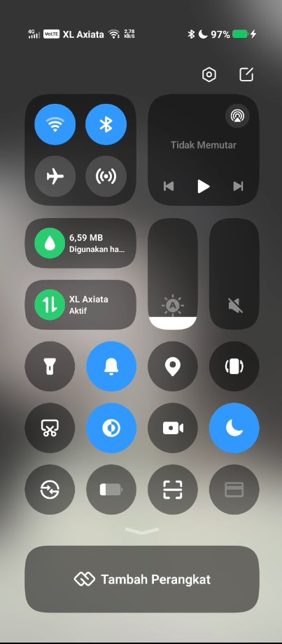
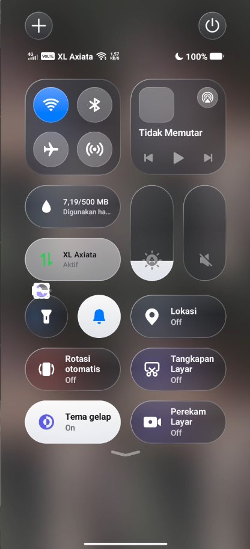

# iOS 27 Control Center for Infinix XOS 15

Module **LSPosed / Xposed** untuk mengubah tampilan dan animasi Control Center bawaan **Infinix XOS 15 (Android 15)** menjadi bergaya **iOS 26/27 Liquid Glass**, lengkap dengan slider kapsul vertikal, animasi spring 120Hz, serta aplikasi pengaturan bawaan.

---

## Preview

| Before (Stock XOS 15) | After (iOS 27 Liquid Glass) |
| :---: | :---: |
|  |  |

---

## Fitur Utama

- **Liquid Glass Renderer (`LiquidGlassDrawable`)**: efek frosted glass gelap & kapsul aktif putih berkilau dengan *directional specular rim* dan *ambient color refraction glow* per tile.
- **iOS Top Action Bar**: tombol kaca **`+`** (buka customizer XOS / tahan lama untuk Settings) dan **`⏻`** (menu Power) di baris atas, dengan status bar tepat di bawahnya.
- **3 Mode Grid Quick Settings**:
  - **Hybrid iOS 26/27** *(default)*: 2 lingkaran + 1 pill di baris pertama, dilanjutkan grid 2 kolom pill.
  - **All 2-Column Glass Pills**: seluruh tile berbentuk kapsul horizontal 2 kolom.
  - **4-Column Glass Circles**: grid 4 kolom lingkaran kaca yang presisi.
- **Vertical Capsule Sliders**: slider Brightness (ikon matahari kuning `#FFCC00`) dan Volume (ikon speaker biru `#32ADE6`) bergaya kapsul Liquid Glass.
- **Liquid Glass Media Card**: kartu pemutar media dengan sudut membulat, tombol output audio kaca, dan teks judul yang rapi.
- **120Hz Spring & Staggered Swipe Animations**: animasi swipe-down bertahap dengan `LAYER_TYPE_HARDWARE` caching dan request refresh rate tertinggi (120Hz) saat panel terbuka.
- **Opsi Sembunyikan Card "Tambah Perangkat"**: tampilan bawah lebih bersih seperti Control Center iPhone.
- **Aplikasi Konfigurasi (`MainActivity`)**: atur opacity glass, intensitas rim, dim backdrop, mode layout, toggle fitur, serta tombol **Apply & Restart SystemUI (Root)**.

---

## Persyaratan

- HP **Infinix** dengan **XOS 15** (Android 15 / API 35, `TranSystemUI`)
- Akses **Root** (Magisk / KernelSU / APatch)
- **LSPosed** (API 93+ dengan dukungan `xposedsharedprefs`)

---

## Cara Instalasi

1. Unduh atau build file `app-release.apk`, lalu pasang di HP.
2. Buka **LSPosed Manager** → tab **Modules** → aktifkan **iOS 27 Control Center**.
3. Pastikan scope berikut tercentang:
   - `com.android.systemui` (**System UI**)
   - `com.ios27.controlcenter` (**iOS 27 Control Center**)
4. Buka aplikasi **iOS 27 Control Center**, sesuaikan pengaturan jika perlu, lalu tekan **Apply & Restart SystemUI (Root)** (atau reboot perangkat sekali).

---

## Build dari Source

Pastikan **JDK 17** dan **Android SDK (API 35)** sudah terpasang, lalu buat file `local.properties` berisi path SDK kamu:

```properties
sdk.dir=PATH_TO_YOUR_ANDROID_SDK
```

Jalankan build:

```powershell
# Debug APK
.\gradlew.bat assembleDebug

# Release APK (R8 minify + shrinkResources)
.\gradlew.bat assembleRelease
```

---

## Struktur Proyek

```text
app/src/main/java/com/ios27/controlcenter/
├── HookEntry.java                 # Entry point LSPosed & self-status check
├── MainActivity.java              # UI pengaturan module
├── prefs/
│   └── ModulePrefs.java           # XSharedPreferences reader (throttled)
├── ui/
│   ├── LiquidGlassDrawable.java   # Renderer Liquid Glass & specular rim
│   ├── IosHeaderIconDrawable.java # Ikon vektor '+' & Power
│   ├── TileAccentPalette.java     # Palet warna aksen & ambient glow ala iOS
│   └── TransparentNoOpDrawable.java
└── hooks/
    ├── ControlCenterHook.java     # Header, connectivity card, media card, IoT card
    ├── TileStyleHook.java         # Grid Hybrid/Pills/Circles & styling tile XOS 15
    ├── SliderHook.java            # Vertical capsule brightness & volume sliders
    └── AnimationHook.java         # 120Hz hardware-layer swipe & spring animations
```

---

## Catatan

- Proyek ini dibuat khusus untuk struktur `TranSystemUI` pada **Infinix XOS 15**. Di versi XOS atau merek lain, nama class internal SystemUI bisa berbeda.
- Gunakan atas risiko sendiri; jika terjadi kendala di SystemUI, cukup nonaktifkan modul di LSPosed Manager lalu reboot.

